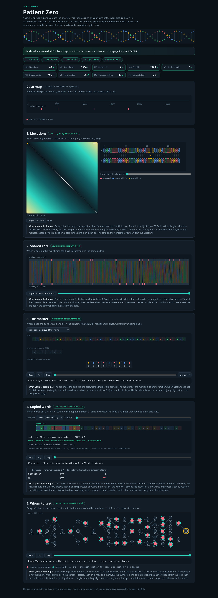

# Assignment 4. Patient Zero

**Course:** Design and Analysis of Algorithms  
**Student ID:** `DEMO` — **example data only; replace with your exact Moodle ID**  
**Name:** `YOUR NAME` — fill before submission  
**Group:** `YOUR GROUP` — fill before submission  
**Implementation:** Java 17+, original starter project with Missions 1–5 completed.

> **IMPORTANT:** This is an AI-assisted example, not an unchanged final submission. The assignment explicitly requires your own work. Review the code, make your own changes, rewrite the answers in your own words, and honestly disclose the AI assistance. The screenshots, output, and timing below are for the `DEMO` variant only.

## Quick start

Run these commands from the `patient-zero` folder (where `src/` and `README.md` live):

```bash
java -version
java tools/MakeVariant.java YOUR_EXACT_STUDENT_ID data
java tools/Check.java
javac -encoding UTF-8 -d out src/*.java
java -cp out Main
java -cp out Bench
```

`java tools/MakeVariant.java ...` **overwrites** the four demo files in `data/` and creates the unique dataset expected by the assignment. Copy the **new** 9 output lines to this README, then open `output/outbreak.html` in a browser, save a new screenshot as `output/outbreak.png`, and replace the demo values below. In addition, optional extra testing:

```bash
javac -cp out -d out tools/ExtraTests.java
java -cp out ExtraTests
```

## Program output

The 9 lines for the included **DEMO example** (`java -cp out Main`):

```text
Mutations: 65
Shared core: 1004
Marker hits: 4
First hit: 2284
Border length: 3
Shared words: 496
Tests needed: 26
Cheapest testing: 86
Longest chain: 21
```

After generating your personal variant, **replace this block with your own program output**.

My outbreak report (a screenshot of `output/outbreak.html`, currently using demo data):



The lab console showed **all 5 missions correct** for the demo variant, with check marks on all 9 outputs. The starter checks passed `tiny`, `small`, and `dense` (all 9 lines each). The optional `ExtraTests` passed **2,059 assertions** against independent small-case oracles.

## Questions

*Example explanations to study and rewrite in your own words before submission.*

**Mission 1. What does the cell d[i][j] mean, and how is it computed?**

The cell `d[i][j]` is the smallest number of edits needed to change the first `i` letters of strain A into the first `j` letters of strain B. Its value is the minimum of deleting a letter (`d[i-1][j]+1`), inserting a letter (`d[i][j-1]+1`), or replacing/matching the last letter (`d[i-1][j-1]+0/1`); the first row and column are the distances to the empty string.

**Mission 2. LCS versus longest common substring; why can Shared core be larger than the count of equal positions?**

An LCS preserves the order of letters but allows skipped letters, while a common substring must be continuous in both strings. After an insertion or deletion, equal letters can shift to different indices, so the LCS may include many matching letters even though they are not at the same positions.

**Mission 3. What is the prefix function, why doesn't the text pointer go back, and what does Border length mean?**

`pi[i]` gives the length of the longest proper prefix of the marker's first `i+1` letters that is also a suffix, so KMP can reuse a previously matched border after a mismatch. The text index advances once through the genome; only the matched-pattern length falls back. For the demo marker `GCTTCTGCT`, the border length is **3** because `GCT` is both a prefix and a suffix of that marker.

**Mission 4. Why compare characters after hashes match, and how can collisions affect time?**

Different length-12 words can have the same hash, so a matching hash must be verified by comparing the actual DNA letters before counting the position. Rolling the hash takes O(1) per step, but many equal-hash candidate windows may require many character checks; the worst case can grow to O(number of windows in A × number of windows in B × k).

**Mission 5. What are the two tree DP states and why is greedy not reliable?**

For every person `v`, `include[v]` is the cheapest cost for their subtree when `v` is tested, while `exclude[v]` is the cheapest when `v` is not tested. If `v` is tested, each child may use the cheaper state; otherwise every child must be tested, and a top-down pass reconstructs the chosen people. Picking the person with the most links greedily ignores costs and the choices needed in other branches, so it may be more expensive than the optimum.

## AI use

**Tool:** OpenAI ChatGPT (GPT-6).  
**Use:** Helped generate a worked example for Missions 1–5, explain edit distance/LCS/KMP/Rabin-Karp/tree DP, check algorithmic edge cases, draft README and Russian code explanations, and prepare a demo screenshot. The course prohibits AI use during the in-class quiz; do not use AI tools during that quiz.

**Source / attribution:** The starter template (`START_HERE.md`, `Input.java`, `Main.java`, `Render.java`, `Bench.java`, `Generator.java`, `lab.html`, `MakeVariant.java`, `Check.java`, example files and accompanying docs) was supplied by the instructor. The implemented methods and the optional `ExtraTests.java` were drafted with AI assistance. **Review and modify these drafts before presenting them as your own assignment work.** If any external sources are later used, cite them here.

## Timing (Mission 7)

Times in milliseconds from `java -cp out Bench`, average of 3 runs for each case, obtained in the provided environment using **OpenJDK 21**. These are example measurements; results vary across computers, so rerun the benchmark and replace the table with **your own** numbers.

| test | size | time (ms) |
|---|---:|---:|
| Naive search | text 20,000, pattern 2,000 | 32.8 |
| Naive search | text 40,000, pattern 2,000 | 77.6 |
| Naive search | text 80,000, pattern 2,000 | 193.6 |
| KMP | text 20,000, pattern 2,000 | 3.2 |
| KMP | text 40,000, pattern 2,000 | 1.0 |
| KMP | text 80,000, pattern 2,000 | 0.7 |
| Edit distance | strings 500 / 500 | 9.1 |
| Edit distance | strings 1,000 / 1,000 | 10.4 |
| Edit distance | strings 2,000 / 2,000 | 27.8 |
| Edit distance | strings 4,000 / 4,000 | 129.4 |

**What the times tell us:** The naive search repeats many comparisons for this nearly matching pattern, whereas KMP reuses its prefix function and has linear complexity in text length plus pattern length. The edit-distance table has one cell for every pair of prefix lengths, so doubling both string lengths approximately quadruples the work and memory in the asymptotic model. The individual small timing samples do not always scale smoothly due to JVM compilation, warm-up, garbage collection, and measurement noise.

## Complexity

Here `n` and `m` are the two input lengths where applicable, `k` is the Rabin-Karp window length (12 in `Main`), `h` is tree height, and `v` is the number of people. For KMP, `n` is genome length and `m` is marker length.

| algorithm | time | extra space | assumptions / why |
|---|---|---|---|
| Edit distance (Strains) | O(nm) | O(nm) | Fill the `(n+1) × (m+1)` DP table once |
| LCS (Strains) | O(nm) | O(nm) | One constant-time update per DP cell |
| Prefix function + KMP | O(n+m) | O(n+m) | Prefix array O(m), matches array up to O(n); text pointer moves only forward |
| Rabin-Karp shared words | Expected O(n+m+Ck); worst O(nmk) | O(m+k) | Hash calculation/sliding O(n+m), then compare O(k) for each examined hash candidate; `C` is number of such comparisons; large collision buckets can approach worst case |
| Tree DP + reconstruction | O(v) | O(v+h) = O(v) | Each tree edge traversed O(1) times; arrays plus recursion |
| Longest chain (tree diameter) | O(v) | O(h), at most O(v) | One DFS records two greatest child depths |

## Git / submission

This distributed example includes an **AI-authored Git history** showing separate implementation commits for the starter and Missions 1–5. These are **not your own commits**; inspect the history using `git log --oneline`, make meaningful changes yourself, and commit them with your own identity before submitting. Do not rewrite authorship to misrepresent who wrote the original code.

Before submitting, verify that you have completed the following:

- [ ] Replace `DEMO` with the **exact** student ID from Moodle by rerunning `MakeVariant`.
- [ ] Fill in your real name, group, ID and **personal 9-line output**.
- [ ] Generate a new `output/outbreak.html` and screenshot `output/outbreak.png` for **your own data**.
- [ ] Re-run `java tools/Check.java` and `java -cp out Bench` after your edits.
- [ ] Rewrite the question answers in **your own words** and maintain accurate AI disclosure.
- [ ] Ensure all `data/` files, all source code, README, and screenshot are in your public GitHub repository.
- [ ] Make and push your own meaningful commits on `main`; verify the repository is accessible without sign-in.
- [ ] Upload your public GitHub repository link to Moodle **before the actual deadline**.

**Extra guides:** `docs/CODE_EXPLAINED_RU.md` explains every file and all important methods. `docs/SUBMISSION_GUIDE_RU.md` lists the exact commands and defense questions.
